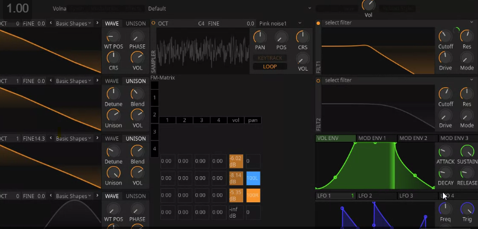

# CLAP plugin in rust

It's still WIP, run the below command to compile it

```
cargo xtask bundle osc3-mcp-rust
```

Working in fl studio v25.1.1

## AI assist configuration

The "AI ASSIST" and "AUDIO COPY" tabs talk to [OpenRouter](https://openrouter.ai)
(an OpenAI-compatible gateway to many models). Open the **settings gear (⚙) in
the top-right header** to set your API key and model — these are shared by both
tabs. Settings are stored **outside** the host project, in a per-user config file:

| OS      | Path                                                       |
|---------|------------------------------------------------------------|
| Windows | `%APPDATA%\TripleOscSynth\config.json`                     |
| macOS   | `~/Library/Application Support/TripleOscSynth/config.json` |
| Linux   | `~/.config/TripleOscSynth/config.json`                     |

The app **auto-generates this file with defaults on first launch** if it's
missing, so you can edit it directly instead of using the in-plugin ⚙ settings
(handy when running inside a host that doesn't forward clipboard paste). A
template is committed as [`config.example.json`](config.example.json) — copy it
to the path above and fill in your key. Format:

```json
{
  "provider": "open_router",
  "api_key": "PASTE_YOUR_OPENROUTER_KEY_HERE",
  "model": "google/gemini-2.5-flash",
  "ollama_url": "http://localhost:11434",
  "ollama_model": "llama3.1",
  "temperature": 0.7
}
```

The settings overlay (⚙) has three left-hand tabs — **AI**, **Color Scheme**
(placeholder), and **About** — and the AI tab lets you pick the backend with a
radio toggle:

- **OpenRouter** (`"provider": "open_router"`) — the hosted cloud gateway.
  - Create a key at [openrouter.ai/keys](https://openrouter.ai/keys).
  - `model` is any OpenRouter slug, e.g. `openai/gpt-4o`,
    `anthropic/claude-3.5-sonnet`, or the default `google/gemini-2.5-flash`.
- **Ollama** (`"provider": "ollama"`) — a **local** server, no API key or
  network needed. Install [Ollama](https://ollama.com), run `ollama serve`, and
  `ollama pull <model>`. `ollama_url` defaults to `http://localhost:11434`;
  `ollama_model` is the local model name (e.g. `llama3.1`).

In both cases the model must support **tool calling**; the Audio Copy "AI Match"
additionally needs **audio input** (the OpenRouter default does both — most
local Ollama models do not, so Audio Copy is best used with OpenRouter).

- Never commit a real key. Treat the file as a secret.

Todo:

- Migrate to vizia - DONE
- Finish pending tasks:
- Add phase offset / detune - DONE
- Add an adsr
- Add a noise option
- Custom waves (Using bezier?)
- Reverb option Frequency gain, phase, detune
- add wt position
- inspiration:
  
- Multiple wavetable oscillators (2–3 minimum)
- WaveTable Position, Phase, Coarse/Fine tuning, Volume
- Unison: Detune, Blend, Spread, Phase Randomization
